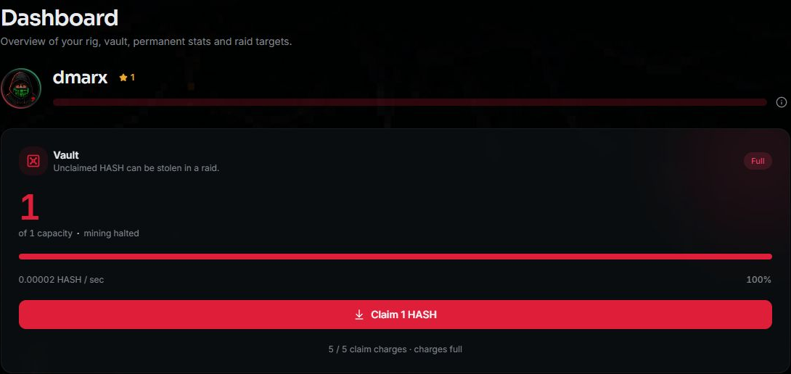
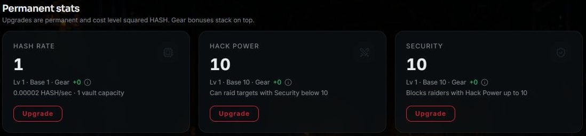
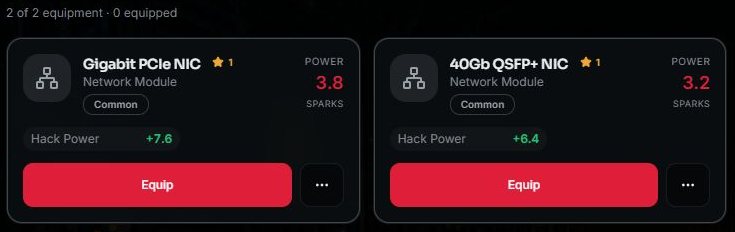
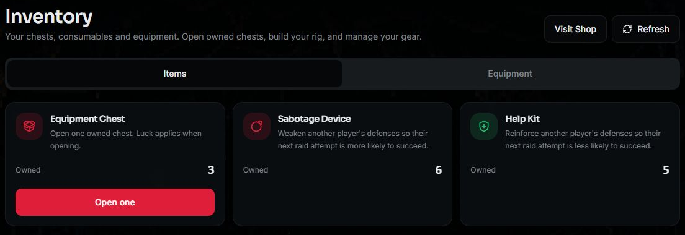
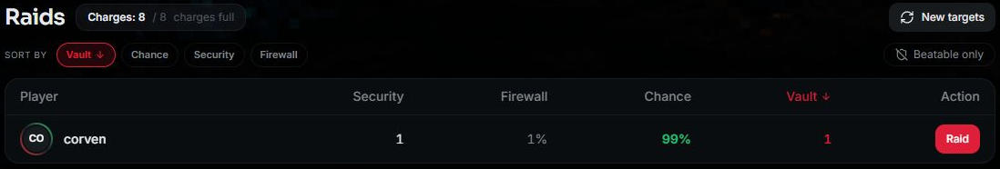
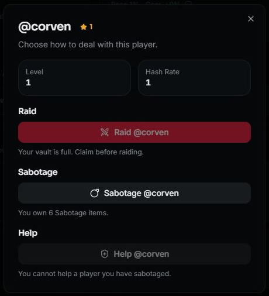
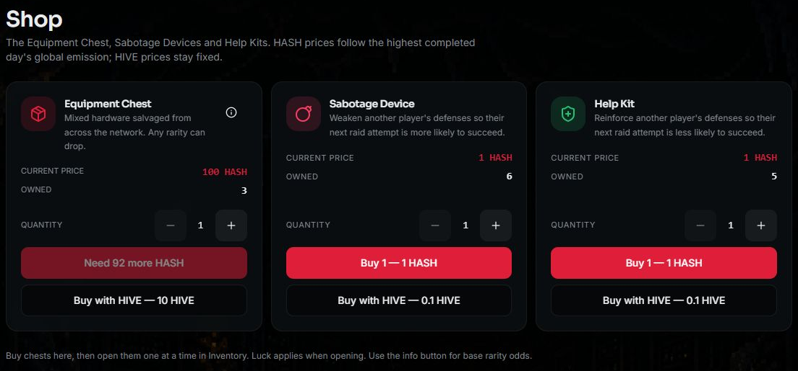
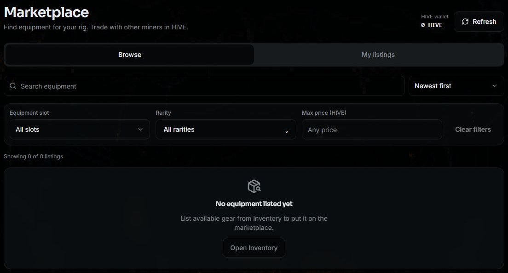
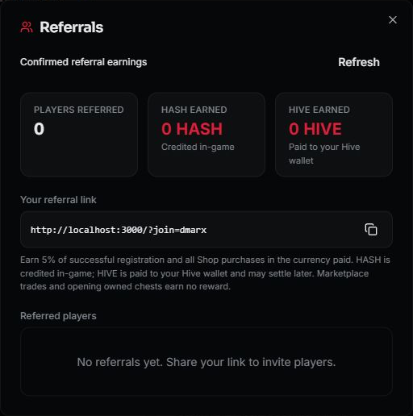
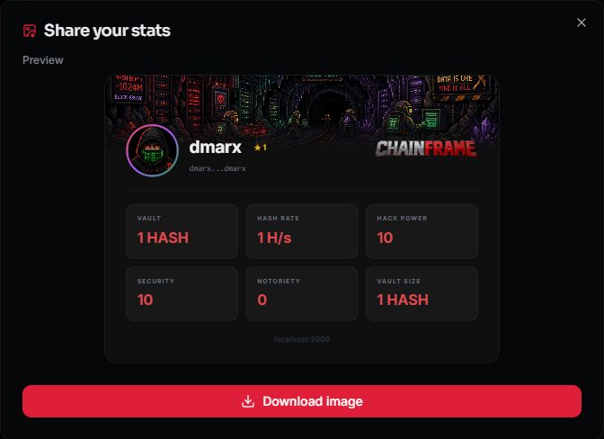

# Introducing Chainframe: Build Your Rig. Mine. Raid. Trade.

Hello, Hive! Meet **Chainframe**, an idle mining and strategy game built around your Hive account.

You start with a virtual mining rig and a small vault. Your rig produces HASH over time. From there, you decide how to grow: improve your permanent stats, increase your vault capacity, collect equipment, challenge other miners, or trade gear for HIVE.

The decision at the center of the game is simple: **how much do you leave exposed while you work toward your next upgrade?**

This first post introduces the current build and walks through what to do when you enter the game. Chainframe is still in development, so the screens and rules described here are a look at the implementation today.

*Screenshots are from the development build. The balances, owned items and target estimates shown are examples, not starting awards or guaranteed outcomes.*

## Your first session

Your Hive username is your game identity. There is no separate game account name to create.

1. **Connect with Hive Keychain.** Enter your Hive username and approve the login signature.
2. **Register through the game.** Gameplay requires a one-time **75 HIVE** registration payment. Signing in and registering are separate steps.
3. **Wait for confirmation.** A confirmed new registration includes **10 spendable in-game HASH** to get you started.
4. **Open Dashboard.** Check your vault, mining rate, permanent stats, active effects and mining rig.
5. **Make your first upgrade.** Hash Rate level 1 to 2 costs **1 HASH**. You can use part of your starting balance without waiting for your first mining claim.

You can read the Wiki before connecting. Once signed in, you can also browse Marketplace and Leaderboard before paying for registration. Gameplay and marketplace purchases require registration.

Use the payment controls inside the app. They attach the information the game needs to match a payment to its purpose.

If someone invited you, open their referral link and sign in **before starting the registration payment**. Check the inviter shown in the registration dialog. Referral links cannot replace an inviter already attached to your account.

## Mine into your vault, then claim

*The vault separates unclaimed mining from spendable game HASH. This example is full, so mining has paused.*

Chainframe's mining is a game simulation: you build a virtual rig rather than run mining software on your computer.

Mining first fills your **vault**. It does not immediately become spendable HASH. To move it into your game balance, use **Claim** on Dashboard.

At the starting Hash Rate level of 1, an unaffected rig produces approximately **2 HASH per day** at its full activity multiplier. The starting vault holds **1 HASH**, so it fills in roughly **12 hours**. Once the vault is full, additional mining does not overflow into your spendable balance.

That makes vault management part of the game from the beginning:

- **Hash Rate upgrades** increase your permanent mining level.
- **Vault staking** spends game HASH to increase storage capacity.
- **Claims** move accumulated vault HASH into your spendable game balance.

*These are the three permanent stats you can upgrade from Dashboard. The preview describes the UI; settlement uses the current server rules.*

Vault staking is permanent in the current build; there is no unstake action. Check the capacity shown in the app before confirming a stake.

Claims use charges. You can hold up to **five claim charges**, with one charge regenerating every **four hours**. Your displayed vault growth is an estimate between confirmed updates; the recorded claim tells you what actually settled.

## Know your balances

Several resources appear in Chainframe, and they have different jobs:

| Resource | What it does |
| --- | --- |
| **Vault HASH** | Unclaimed mining and raid proceeds. This is the balance exposed to raids. |
| **Game HASH** | Spendable in-game balance for permanent upgrades, vault staking and HASH Shop purchases. |
| **Wallet HASH** | Hive Engine tokens in your Hive wallet, separate from your game balance. |
| **SPARKS** | Earned by salvaging equipment and spent on equipment upgrades. |
| **HIVE** | Used for registration, fixed-price Shop purchases and equipment trading. |
| **XP** | Earned through supported progression actions and shown through your player level. |
| **Notoriety** | Built through raid outcomes and used in ranking and withdrawal capacity. |

Claiming is an internal move from vault HASH to game HASH. Depositing and withdrawing move HASH between your Hive wallet and the game; they require separate confirmation.

## Build your rig with equipment

Your rig has six equipment slots: **ASIC Miner, Motherboard, Power Supply, Cooling System, Network Module and Firmware Chip**.

Equipment comes in five rarities, from **Common** through **Legendary**, with rolled stats that make individual pieces different. Each card shows its slot, rarity, item level, stats and **POWER / SPARKS** value. That power value is the item's salvage value, not its HIVE listing price.

*Two owned Common items with different stat rolls and salvage values.*

The equipment loop starts in Shop:

1. Buy an **Equipment Chest** with game HASH or HIVE.
2. Find the owned chest in **Inventory → Items**.
3. Choose **Open one** to consume a chest and reveal its equipment. Opening an owned chest has no additional HASH or HIVE charge.
4. Manage the resulting item in **Inventory → Equipment**.

*Buy chest stock in Shop, then open an owned chest from Inventory. The quantities here belong to the example account.*

You can equip gear, upgrade it with SPARKS, list eligible spare gear on Marketplace, or salvage it. Salvage permanently consumes the item and credits its current SPARKS value. Unequip an item before selling or salvaging it.

Equipped gear now contributes to the stats used by mining and raids. **Hash Rate** bonuses increase mining output; **Hack Power** and **Security** affect who can raid whom; **Firewall** can block an eligible raid; **Exploit** gives raid critical chance; and **Luck** improves Sabotage and Help success. Unequipped gear contributes nothing. The card's POWER / SPARKS score is its salvage value.

Chest rarity uses the same fixed odds for everyone: **70% Common, 20% Uncommon, 8% Rare, 1.8% Epic and 0.2% Legendary**. Luck does not change these odds.

## Choose when to raid

*Use the target list to inspect players. Its displayed chance uses the shared raid rules; a percentage still does not guarantee a particular outcome.*

Raids introduce direct competition with other players' vaults. **Hack Power** and **Security** include permanent upgrades and equipped gear. Your effective Hack Power must be **strictly greater** than the defender’s effective Security to raid them; equal stats are insufficient. Sabotage can temporarily change these totals.

Once you pass that gate, the defender’s **Firewall** is their chance to block your raid. Your **Exploit** is the chance of a raid critical: a normal 30% stolen roll becomes **60%** on a critical. Exploit does not improve ordinary raid success.

A successful raid can move whole HASH from the target's vault into yours, subject to your available vault space. The result is still vault HASH: you need to claim it before spending it.

There is also a cost to failure. **A failed raid can destroy part of your own vault HASH.** A win can resolve with zero HASH credited because of whole-HASH rounding or capacity limits. The target can lose more than you receive when your vault has insufficient space; excess taken HASH is destroyed.

Before attempting a raid, check your free vault space, available raid charges and the target's information. Raid charges regenerate over time. The chance shown by the interface is an estimate, not a guaranteed outcome.

Notoriety reflects actual raid outcomes, including credited stolen HASH and defending against failed attacks. The Leaderboard combines Notoriety, current mining output and total XP, so progression has more than one path. Rankings currently have no seasonal prize system.

## Sabotage a rival—or help another miner

Shop also sells **Sabotage Devices** and **Help Kits**. Each valid attempt consumes one owned item and targets one of three stats: Hash Rate, Hack Power or Security.

Your **Luck stat comes from permanently staked vault HASH and equipped gear**; without either bonus it is 0%. Sabotage and Help each have a separate **25% base success chance**, plus your Luck, capped at 100%. For example, 0.025% Luck gives a 25.025% success chance. The base chance does not increase your general Luck stat. If the Luck roll succeeds, a separate roll sets **10–50% strength**. If it fails, your item is still consumed and the target’s effects stay unchanged. These actions have no critical multiplier; Exploit is reserved for raids.

You can sabotage a stronger player even when their Security prevents you from raiding them.

- **Sabotage** reduces the effective strength of the chosen stat. A stat can have one active sabotage at a time.
- **Help** counters an existing sabotage on a chosen stat. It restores lost strength rather than raising a stat above its base value.

You cannot target yourself. Protected players cannot receive new sabotage.

**You also cannot help a player while any sabotage you applied to them remains active—even if you choose a different stat.** Other players can still help them. Your restriction ends once all your sabotage on that player is fully countered or cleared. An ineligible Help attempt consumes nothing. This differs from a valid attempt that fails its Luck roll, which consumes one Help Kit.

*The player dialog explains why Help is unavailable. No action was submitted to capture this screen.*

Effects have no countdown expiry. Help can reduce them, and the affected player's claim or a raid against them clears their effects. Check **Active effects** on Dashboard to see what is affecting your own rig.

## Shop: buy chests and consumables

*The Shop shows both payment choices and current ownership. HASH prices shown here reflect this build's current emission tier.*

Shop and Marketplace serve different purposes. **Shop** supplies Equipment Chests and consumables. **Marketplace** lets players trade individual equipment items for HIVE.

Current fixed HIVE Shop prices are **10 HIVE per Equipment Chest** and **0.1 HIVE per Sabotage Device or Help Kit**. HASH prices depend on the game's completed-day claimed-emission tier. Check the current quote in Shop instead of assuming the HASH price will stay fixed.

## Marketplace: trade equipment for HIVE

*The actual development market was empty during this capture. Browse, My listings and the filters are shown as they appear in the game; no example sale was created for this post.*

Marketplace is where a useful spare item can find another owner. Unlike a chest purchase, you can inspect the exact equipment, its rolled stats and the seller's HIVE price before buying.

**To browse or buy:** open Marketplace, use the name search, equipment-slot and rarity filters, or set a maximum HIVE price. Your HIVE wallet balance is shown separately from game HASH. Select an available listing, approve the in-app HIVE purchase through Keychain, then wait for confirmation. A confirmed purchase puts the equipment in your Inventory; buying requires paid registration even though signed-in players can browse beforehand.

**To sell:** open **Inventory → Equipment**, choose **More actions → Sell** on an eligible unequipped item, and enter your own positive HIVE price. Prices use increments of 0.001 HIVE. Review it before signing, then manage the listing under **My listings**. Listed items cannot be equipped while they are for sale.

Marketplace sellers choose a HIVE price for their equipment. A completed sale has a **5% fee**, rounded down to milli-HIVE. For example, a **0.100 HIVE** sale pays **0.095 HIVE** to the seller and allocates **0.005 HIVE** to treasury. Buying equipment does not require opening another chest.

The 5% sale fee is separate from referral rewards. A successful purchase remains completed if forwarding the fee to treasury takes longer: confirmed ownership and the buyer's ability to use the item do not depend on that later forwarding step. Check Histories for recorded marketplace outcomes rather than treating a submitted payment as a completed trade.

## Invite friends through Referrals

*Open the account menu and choose Referrals. The example account has no referred players yet; these are real recorded totals. The localhost link is from development—copy your link from the public game when inviting someone.*

Your referral link connects an eligible new player's account to you. Open **account menu → Referrals**, copy your link, and ask your friend to open it and sign in before paying for registration. Attribution is assigned once; another invitation does not overwrite it.

You receive **5% of your referred player's first successful paid registration and every successful Shop purchase**, calculated from the actual total in the currency they paid:

| Their payment | Your referral reward |
| --- | --- |
| 75 HIVE registration | 3.75 HIVE to your Hive wallet |
| 10 HIVE Equipment Chest purchase | 0.5 HIVE to your Hive wallet |
| 100 HASH Shop purchase | 5 HASH credited to your game balance |

HIVE rewards round down to 0.001 HIVE. HASH rewards stay HASH; HIVE rewards do not become game HASH. The Referrals view separates **HASH earned** from **HIVE earned**, and its paid HIVE total includes confirmed payouts rather than pending obligations.

Your friend's registration or purchased stock can confirm before a delayed HIVE referral payout. Referral rewards do not add a surcharge to their quoted price, and the new player's starting 10 HASH is separate from your reward. Self-referrals, refunded payments, marketplace trades and opening an already-owned chest do not create a referral reward.

## Download and share your stats

*The current sharing dialog previews the card and downloads it as an image. The hostname shown here is the local capture environment.*

Want to show the rig you are building? Open **account menu → Profile → Share stats**. The card brings together your username, level, chosen avatar/banner and displayed vault, Hash Rate, Hack Power, Security, Notoriety and vault capacity.

Check the preview, then choose **Download image** to save a PNG named `<username>-chainframe-stats.png`. You can attach it to your own PeakD post or share it with the community. It is a snapshot of displayed profile stats, not a payment receipt or proof of future mining output.

If you are inviting someone, include your referral link separately alongside the image. Downloading or sharing the card alone does not assign an inviter to another account.

## Move HASH between your wallet and the game

Use the game's **Deposit** or **Withdraw** flow. The current interface uses whole-HASH amounts. Withdrawal capacity starts at **10 HASH per rolling 24-hour window** and increases with Notoriety. Deposits and paid withdrawals are separate from a vault claim.

## Follow confirmation, not just the wallet popup

Approving an action in Keychain means it was **submitted**. It does not yet prove a purchase, deposit, chest opening or withdrawal has finished.

Use **Game activity → Submitted** to follow pending requests. Confirmed results appear in Recent history, and the account menu's **Histories** view lets you browse recorded activity by category.

A withdrawal marked **queued** is awaiting payout confirmation; it is not a completed payment. If an action is delayed or uncertain, check its status rather than submitting it again just because the confirmation has not appeared yet.

## A simple route through your first day

You do not need to use every system immediately. A useful first session is to:

- Confirm registration and check your starting 10 HASH.
- Buy your first Hash Rate upgrade and watch how the vault fills.
- Decide whether to spend on more upgrades or permanent vault capacity.
- Claim before capacity stops further accumulation, while keeping claim charges in mind.
- Explore Shop, Inventory and Marketplace before committing to equipment purchases.
- Find your referral link and download a stats card when you want to introduce a friend.
- Read the raid risks, check your equipment totals and inspect the target’s defenses before competing.

Chainframe brings idle progression and player decisions into the same loop. Your rig keeps producing, but what you claim, spend, expose, salvage or trade is up to you.

Start with the in-game **Wiki**, and join the [Chainframe Discord](https://discord.gg/tBBPhRt7kW) to follow development and share feedback.

**What would you focus on first: growing your mining level, building a bigger vault, collecting gear, or challenging other miners?**
