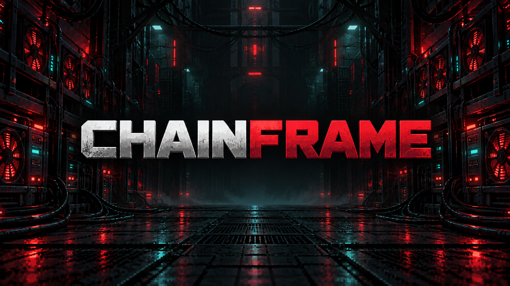

# 🏆 Chainframe Invite Challenge: 14 Days, 3 Winners, 150 HIVE!

**14 days. 3 winners. 150 HIVE in rewards!**

The Chainframe Invite Challenge starts on **19 October 2026 at 8:00 AM Singapore time**. Invite friends who are interested in Chainframe, grow the community and compete for HIVE rewards.

## 🎁 150 HIVE prize pool

| Place | Reward |
| --- | ---: |
| 🥇 1st | **75 HIVE** |
| 🥈 2nd | **45 HIVE** |
| 🥉 3rd | **30 HIVE** |

Staff will verify the results before awarding prizes.

## 📅 Event schedule

| | Singapore time (UTC+8) | UTC |
| --- | --- | --- |
| 🟢 Starts | **19 October 2026, 8:00 AM** | **19 October 2026, 00:00** |
| 🔴 Ends | **2 November 2026, 8:00 AM** | **2 November 2026, 00:00** |

The event runs for exactly 14 days. Invites must be recorded from the start time and before the end time to qualify.

## 📌 How to participate

1. [Join the Chainframe Discord](https://discord.gg/tBBPhRt7kW).
2. Create your unique invite link from **#onboarding**.
3. Share it with friends interested in Chainframe.
4. Encourage genuine participation in the community.
5. Check **#event-leaderboard** for rankings.

Use your own unique Discord invite when inviting friends so the event can record your invitations.

## 📜 Event rules

- Only genuine new members qualify.
- Fake accounts, bots and alternate accounts are prohibited.
- Rejoins and duplicate joins do not count.
- Members who leave before verification are excluded.
- No spam, misleading invites or unsolicited promotions.
- Only invites recorded during the event count.
- Staff will verify all results before awarding prizes.

**Fraudulent activity may result in disqualification.**

## 🎮 A starter pack for qualifying new players

During the same event window, qualifying new paid registrations completed after the starter-pack offer goes live receive:

- **4 unopened Equipment Chests**
- **10 Sabotage Devices**
- **10 Help Kits**

These items are in addition to the normal **10 HASH** starting balance. Registration costs **75 HIVE**; the starter items have no additional charge. Signing in alone does not complete registration or award the package.

Your verified Hive registration payment time determines event eligibility. A qualifying payment made before the deadline keeps its eligibility if confirmation is delayed. Already-completed registrations from before this offer goes live are not included; there is no retrospective award.

After registration confirms, find the items in **Inventory → Items**. Open Equipment Chests individually to roll gear; the chests do not arrive pre-opened and no rarity is guaranteed. Each valid Sabotage or Help attempt consumes one corresponding item, even if its success roll fails. Read the in-game Wiki before using them.

**The two promotions are independent.** You do not need to rank in the Discord challenge to receive the registration starter pack. Discord invite rankings are separate from Chainframe's in-game referral links and referral rewards. The free starter items generate no extra referral reward.

## 🏆 Winner announcement

Winners will be announced in **#event-announcements** after staff verification.

[Join the Chainframe Discord](https://discord.gg/tBBPhRt7kW), create your invite in **#onboarding**, and help welcome new players.

**Good luck, Chainframe community! 🚀**
